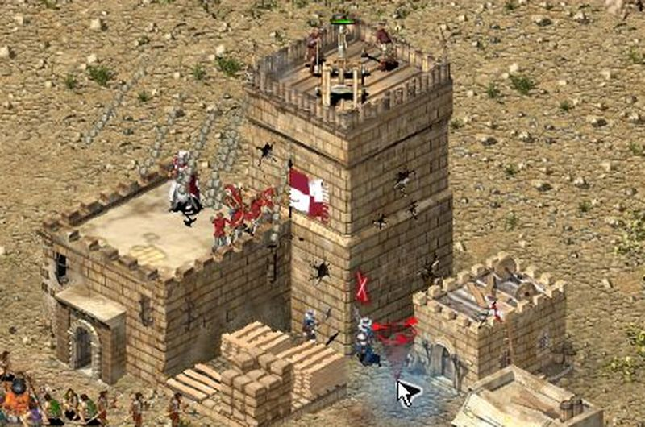

# Custom Projectiles

自定义单位发射的弹药、射击频率与射程，以及它们优先攻击的目标。

## 使用方法

1. 如需正常游玩，请将 **弹射物配置文件（YAML）** 留空。
2. 将扩展文件夹或 ZIP 压缩包中的 `vanilla-projectiles.yml` 复制到游戏目录下的 `ucp/resources/custom-projectiles/`。如果该文件夹不存在，请先创建它，然后编辑副本并在 **自定义 > Balance Changes** 中选择该文件。
3. 重启游戏。

## 可实现的效果

在你的副本中找到对应的单位，将其 `native` 值替换为下面显示的值。

### 减慢弓箭手装填速度

增加欧洲弓箭手两次射击之间的间隔。

```yaml
units:
  European archer:
    interval: 600
```

### 增加投石车射程

让投石车能够瞄准最远 40 格外的目标。

```yaml
units:
  Catapult:
    interval: 700
    range: 40
```

### 一次发射更多石块

让塔楼投石机每次齐射发射十块石头。

```yaml
units:
  Mangonel:
    count: 10
    spread: 48
```



### 按目标选择弹药

让投石车在攻击敌方投石车时自动发射奶牛。

```yaml
units:
  Catapult:
    interval: 700
    ammo_by_target: {units: {Catapult: cow}}
```

## 存档

修改配置文件后，存档仍可加载：射击计时器会重新开始，已更改的自定义图像会恢复默认外观。关闭本模块时也可以加载存档。在文件开头加入 `allow_config_changes_on_load: false`，即可拒绝使用其他设置创建的存档。

*注：此为机器翻译，尚待人工审校。*
